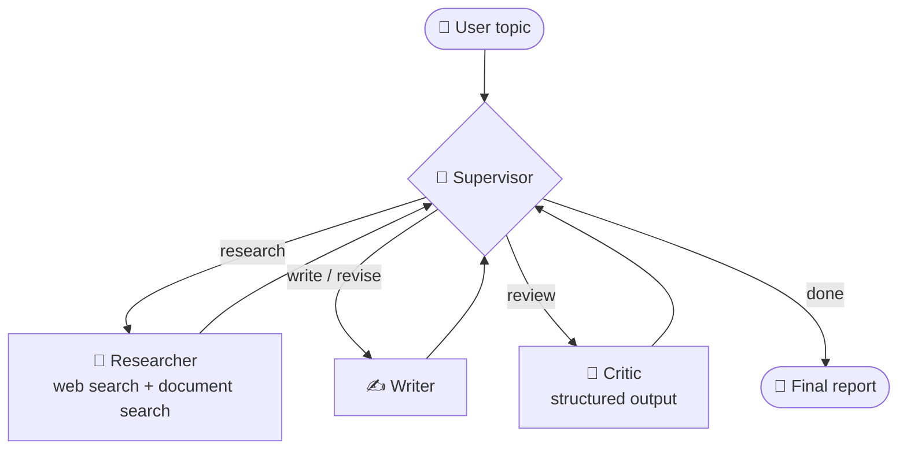
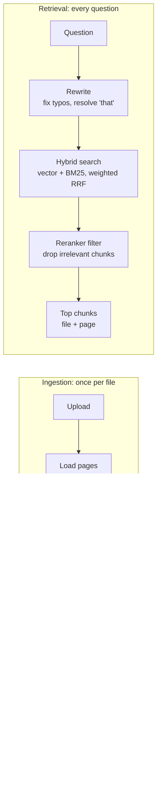

# 🔬 AI Research Assistant: A Multi-Agent LangGraph System with RAG

A multi-agent research system built with **LangGraph**. Give it a topic, and a team of AI agents researches **both the web and your own documents** (PDFs, Word files, notes), writes a cited Markdown report with **page-level citations** and relevant diagrams, and reviews its own work before delivering it. You can then chat with each report.

It runs **locally** with plain files, or **online** with Neon Postgres + pgvector, where each person **signs in** and sees only their own research, and documents can be **private or shared**.

**Live demo:** `<your Streamlit app URL>` (invite only)


---

## ✨ Features

### Multi-agent research
- **Supervisor pattern:** a supervisor agent coordinates three specialist agents
- **Live web research:** the researcher uses the Tavily search API and collects source URLs
- **Diagrams and images:** relevant images are found during research, checked so broken links are dropped, and embedded where they fit
- **Self-review loop:** a critic agent scores each draft and requests either a rewrite or more research
- **Code-enforced guardrails:** the workflow is guaranteed to finish, no matter how the LLM behaves

### RAG over your own documents
- **Document library:** upload PDF, Word, TXT or Markdown files; both the researcher and the chat use them
- **Page-level citations:** document facts are cited like `[2, p. 282]`, and the References list is generated **by code** from verified sources, so citations cannot be invented
- **Hybrid retrieval:** vector search combined with BM25 keyword search, fused with weighted Reciprocal Rank Fusion
- **Query rewriting:** fixes typos and resolves follow-up questions such as *"explain that more simply"*
- **Relevance filtering:** a cross-encoder reranker removes irrelevant passages, so the system says *"not found"* instead of citing unrelated pages
- **Clean ingestion:** page-by-page chunking, text clean-up, extraction-quality checks, bibliography and index filtering, duplicate detection
- **Evaluation suite:** synthetic test set, retrieval ablation study, and LLM-as-judge answer grading

### Accounts and privacy
- **Email + password accounts** with bcrypt-hashed passwords
- **Invite only:** only emails on an allowlist can sign up, and removing an email revokes access
- **Private history:** each user sees only their own research and chats
- **Shared + private documents:** uploads are private to their owner; the admin can share documents with everyone
- **Brute-force protection:** accounts lock for 15 minutes after 5 failed logins

### App
- **Live streaming:** step-by-step agent progress, plus reports and chat answers typing themselves out token by token
- **Follow-up chat:** ask questions about any finished report, with the conversation remembered per thread
- **Persistent history:** every run is saved with its own `thread_id` using a LangGraph checkpointer
- **Fault tolerance:** automatic retries at both the LLM-call level and the graph-node level
- **Observability:** full tracing of every LLM and tool call with LangSmith
- **Two interfaces:** a command-line app and a Streamlit web app

---

## 🏗️ Architecture



Every worker reports back to the supervisor, which decides what happens next. All agents share a single **state** object, the team's common notebook.

When a question is sent to a thread whose report is already finished, the graph routes straight from `START` to a **chat agent** instead of the supervisor. It answers using the saved report, the research notes, and passages retrieved from the user's documents.

| Agent | Role | Technique |
|---|---|---|
| 🧭 **Supervisor** | Routes work between agents | Rule-based guardrails + LLM routing with structured output |
| 🔎 **Researcher** | Searches the user's documents and the web; collects facts, sources and images | Tool-calling ReAct agent with two tools: `search_documents` and Tavily |
| ✍️ **Writer** | Writes and revises a cited Markdown report | LLM with strict grounding rules; citations and references finalised by code |
| 🧐 **Critic** | Scores drafts and gives actionable feedback | Structured output (Pydantic) with a code-enforced threshold |
| 💬 **Chat agent** | Answers follow-up questions about a report | Conversation-aware retrieval over the user's documents |

### Routing logic

| Situation | Next step | Decided by |
|---|---|---|
| Draft approved | Finish | Code |
| Writer just finished | Critic (always) | Code |
| Critic rejected, draft limit reached | Finish (best effort) | Code |
| No research yet | Researcher | Code |
| Researcher just finished | Writer | Code |
| Critic rejected the draft | Researcher **or** writer | **LLM** |

### RAG pipeline



### Storage: one switch, two backends

| Data | Local (no `DATABASE_URL`) | Online (`DATABASE_URL` set) |
|---|---|---|
| LangGraph checkpoints (history, chat) | SQLite file | Postgres (`PostgresSaver`) |
| Threads, documents, users | SQLite file | Postgres |
| Chunk embeddings | Chroma | Postgres + **pgvector** |
| Login | Not required | Required |

---

## 🧠 Key design decisions

1. **LLM judges, code enforces.** Rules that must always hold (every draft gets reviewed, revision limits, termination) are `if` statements, not prompt instructions. The LLM is used only for genuine judgement calls.
2. **Structured output for decisions.** The critic and supervisor return typed Pydantic objects, so code can act on their decisions reliably.
3. **Shared state with reducers.** Research notes, sources and images use `operator.add` reducers, so each research round appends rather than overwrites.
4. **Never trust LLM-generated URLs or references.** The writer can only embed image URLs the researcher verified, and may only cite numbered sources that really exist. Code removes invalid citations, renumbers the rest, and builds the References list itself.
5. **Fail loudly.** Defensive checks turn silent misbehaviour, such as a missing state key or garbled PDF text, into an immediate, clear error.
6. **Separate logic from presentation.** `run_research()` streams progress through `on_step` and `on_token` callbacks, so the CLI and the web UI share the same engine.
7. **One research topic = one thread.** The checkpointer restores a thread's saved state, so every new topic gets a fresh `thread_id`.
8. **Retrieval is only as good as extraction.** Chunks are created page by page so every chunk knows its page, and bibliography and index pages are filtered out because they match keywords but explain nothing.
9. **Measure, don't guess.** The final retrieval setup was chosen from evaluation results rather than intuition (see below), and both choices remain configuration flags.
10. **One switch, two backends.** A single setting, `DATABASE_URL`, moves every table and all embeddings from local files to Postgres. The rest of the code doesn't know which backend is active.
11. **Security lives in the backend.** The UI hides buttons people aren't allowed to use, but ownership and sharing are checked again in the backend functions. Hiding a button is not security.
12. **Who's asking is run context, not state.** The user's ID travels in the graph's `config`, taken from the login session. The LLM can never change which documents it is allowed to search.

---

## 📏 Evaluation

`python run_eval.py` measures retrieval and answer quality separately, because they fail for different reasons.

**Setup**
- **Test set:** 20 questions generated from random passages across two documents (an 801-page deep learning textbook and a 55-page thesis on satellite image deblurring), each with a known source page, plus 3 out-of-scope questions the documents cannot answer.
- **Retrieval** counts as correct when the passage's PDF page appears in the results. Metrics: Hit@1, Hit@5 and MRR.
- **Answers** are graded by `gpt-5-mini` as an LLM judge, from 1 to 5, on faithfulness (every claim supported by the retrieved passages), relevance and correctness. Abstention is measured too: does the system say *"not found"* when, and only when, it should?
- The saved test set is reused between runs, so results are directly comparable.

### Retrieval: ablation study (top 5)

Each row adds or removes one technique, to measure what each one contributes.

| Method | Hit@1 | Hit@5 | MRR |
|---|---|---|---|
| Vector search only | 0.60 | 0.90 | 0.72 |
| Hybrid (vector + BM25, RRF) | 0.70 | 0.95 | 0.79 |
| Hybrid + reranker ordering | 0.60 | 0.90 | 0.71 |
| Hybrid + query expansion | 0.65 | 0.80 | 0.70 |
| Full pipeline (expansion + reranker ordering) | 0.60 | 0.90 | 0.72 |
| **Final setup** (corrected query, hybrid order, reranker as filter) | **0.75** | **0.95** | **0.81** |

### Answers: how each change moved the scores

| Version | Faithfulness | Relevance | Correctness | Correct abstentions | False abstentions |
|---|---|---|---|---|---|
| Baseline, judged by `gpt-4o-mini` | 5.00 | 5.00 | 5.00 | 3/3 | 0/20 |
| Stricter judge (`gpt-5-mini`) | 4.55 | 4.80 | 4.55 | 3/3 | 0/20 \* |
| + answer prompt rules | 4.70 | 5.00 | 4.65 | 3/3 | 0/20 |
| **+ final retrieval setup** | **4.85** | **5.00** | **4.95** | **3/3** | **0/20** |

\* At this point the metric only counted retrieval-level abstentions and missed one answer-level "not found". The metric was fixed afterwards.

### Migration parity: local files vs Neon Postgres

After moving storage from Chroma + SQLite to Postgres + pgvector, the same test set was run against the cloud database.

| | Local (Chroma + SQLite) | Online (Neon + pgvector) |
|---|---|---|
| Vector search only (Hit@1 / Hit@5 / MRR) | 0.60 / 0.90 / 0.72 | 0.60 / 0.90 / 0.72 |
| Final setup (Hit@1 / Hit@5 / MRR) | 0.75 / 0.95 / 0.81 | 0.75 / 0.95 / 0.81 |
| Faithfulness / relevance / correctness | 4.85 / 5.00 / 4.95 | 4.80 / 5.00 / 4.90 |
| Abstentions (correct / false) | 3/3, 0/20 | 3/3, 0/20 |

Retrieval is identical; the small answer differences are within the judge's run-to-run variation.

### What the evaluation changed

- **Query expansion hurt retrieval.** Three alternative queries produced six ranked lists that outvoted the two lists from the user's own question. Weighted RRF reduced the damage, but expansion still did not beat plain hybrid search, so it is **off by default**. The rewrite step still corrects spelling and resolves follow-up questions in chat.
- **The reranker ranked academic text worse than hybrid search** (Hit@1 0.70 → 0.60), probably because the small MiniLM model was trained mainly on web search queries. But its scores separate relevant from irrelevant passages perfectly, so it is now used **only as a relevance filter**, while hybrid search decides the order.
- **The weakest answers were generation failures, not retrieval failures:** an over-cautious *"not found"* and a reversed comparison, both with the correct passages retrieved. Prompt rules written from these specific cases fixed them.
- **A same-model judge gave every answer 5/5**, a ceiling effect that made the metric useless. A stronger judge made the scores informative.

### Limitations

- **Small sample:** with 20 questions, one question is worth 0.05. The final setup's lead over plain hybrid is a single question and within noise.
- **Synthetic questions are easier than real ones,** because they are written while looking at the passage. That favours literal matching and may understate the value of query rewriting.
- **Strict ground truth:** only the source page counts as correct, even when another page also answers the question.
- **LLM judges are imperfect** and vary slightly between runs.

---

## 🔐 Security

- **Passwords are never stored.** Only bcrypt hashes are kept (cost factor 12, a random salt per password). bcrypt is deliberately slow, which makes mass password guessing impractical.
- **Login failures are generic:** always *"Wrong email or password"*, never which one was wrong. A login for an unknown email takes as long as a wrong password, so response times can't reveal which accounts exist.
- **Lockout:** 5 failed attempts lock the account for 15 minutes.
- **Authorisation:** an email allowlist controls who may sign up and log in. Every thread and document has an owner, and ownership is checked in the backend before data is shown, deleted or shared.
- **Retrieval is scoped per user:** vector search and keyword search only consider documents the user owns or that are shared.
- **Secrets stay out of the repository:** API keys and the database URL live in `.env` locally and in the host's secrets settings online.

**Known limitations**
- **Emails are not verified.** The allowlist checks that an email is invited, not that the person signing up owns it, so invited users should create their accounts promptly. Email verification or Google sign-in would close this gap.
- **Refreshing the browser logs you out.** Login state lives in the browser session; "remember me" would need secure cookies.

---

## 📁 Project structure

```
research-assistant/
├── app/
│   ├── config.py            # Models, limits, thresholds, RAG and account settings
│   ├── state.py             # Shared state schema (TypedDict + reducers)
│   ├── tools.py             # Tavily web search tool
│   ├── graph.py             # Graph wiring: routing, nodes, retry policies
│   ├── db.py                # One database layer for SQLite and Postgres
│   ├── storage.py           # Checkpointer (SQLite or Postgres) + thread history
│   ├── auth.py              # Accounts: sign-up, login, bcrypt hashing, lockout
│   ├── agents/
│   │   ├── supervisor.py    # Routing: guardrails + LLM decision
│   │   ├── researcher.py    # ReAct agent: web + document search, sources, images
│   │   ├── writer.py        # Report writing + citation and reference guardrails
│   │   ├── critic.py        # Structured review
│   │   └── chat.py          # Follow-up Q&A with document retrieval
│   └── rag/
│       ├── store.py         # Vector storage (Chroma or pgvector) + document registry
│       ├── ingest.py        # Load, clean, filter, chunk, embed, store; delete and share
│       ├── retrieval.py     # Rewrite, hybrid search, weighted RRF, reranker filter
│       ├── tools.py         # Per-user search_documents tool for the researcher
│       └── evaluation.py    # Test set generation, retrieval + answer evaluation
├── main.py                  # CLI + run_research() / ask_followup() engine
├── streamlit_app.py         # Web UI: login, research, history, chat, document library
├── run_eval.py              # Runs the evaluation suite
├── claim_existing_data.py   # One-time migration: assigns unowned data to the admin
├── pin_requirements.py      # Pins requirements.txt to the tested versions
├── test_ingest.py           # Manual check: index a file and search it
├── test_retrieval.py        # Manual check: compare plain vs full retrieval
├── data/                    # Local database, vector store, eval results (git-ignored)
├── requirements.txt
└── .env.example             # Template for API keys and settings
```

---

## 🚀 Getting started

### Prerequisites

- Python 3.10+
- An [OpenAI API key](https://platform.openai.com/api-keys)
- A [Tavily API key](https://tavily.com) (free tier available)
- *(Optional)* A [LangSmith API key](https://smith.langchain.com) for tracing
- *(Optional, for online mode)* A [Neon](https://neon.com) Postgres database

### Run locally (no database needed)

```bash
git clone https://github.com/<your-username>/ai-research-assistant.git
cd ai-research-assistant

python -m venv .venv
# Windows:
.venv\Scripts\activate
# macOS/Linux:
source .venv/bin/activate

pip install -r requirements.txt
```

Copy `.env.example` to `.env`, fill in your API keys, and leave `DATABASE_URL` empty. Local mode needs no login. The first document search downloads the reranker model (about 34 MB).

### Run with Postgres and accounts

1. Create a Neon project and copy its **direct** (non-pooled) connection string.
2. In `.env`, set `DATABASE_URL`, `ADMIN_EMAIL` (your email) and `ALLOWED_EMAILS` (comma-separated invitees, including you).
3. Start the app and create your account with your admin email. Tables are created automatically on first use.
4. *(Only if you have earlier data without an owner)* run `python claim_existing_data.py` to assign it to your account.

---

## ▶️ Usage

**Web UI:**
```bash
streamlit run streamlit_app.py
```
- Add documents in the sidebar's **📚 Document library**. They're private to you; the admin can share documents with all users.
- Past research appears under **History**. Open any report to read it or chat with it.

**Command line:**
```bash
python main.py
```

**Evaluation:**
```bash
python run_eval.py          # reuse the saved test set
python run_eval.py --new    # generate a new test set from your current documents
```

---

## ☁️ Deployment (Streamlit Community Cloud + Neon)

1. Push the repository to GitHub. `.env` and `data/` are git-ignored and must never be committed.
2. On [share.streamlit.io](https://share.streamlit.io), create an app from the repository with main file `streamlit_app.py`.
3. Under **Advanced settings**, choose the same Python version you use locally, and add these **Secrets**:
   ```toml
   OPENAI_API_KEY = "sk-..."
   TAVILY_API_KEY = "tvly-..."
   MODEL_NAME = "gpt-4o-mini"
   DATABASE_URL = "postgresql://...neon direct connection string..."
   ADMIN_EMAIL = "you@example.com"
   ALLOWED_EMAILS = "you@example.com,friend@example.com"

   # Optional: tracing
   LANGSMITH_TRACING = "true"
   LANGSMITH_API_KEY = "lsv2_..."
   LANGSMITH_PROJECT = "research-assistant-online"
   ```
4. Deploy. Secrets are exposed to the app as environment variables, so no code changes are needed.

**What to expect online:** the app sleeps after a period without visitors and wakes on the next visit; the Neon database pauses after 5 idle minutes and resumes on the next query; the reranker model is re-downloaded after each restart. All data lives in Neon, so nothing is lost when the app restarts.

---

## ⚙️ Configuration

| Setting | Where | Default | Purpose |
|---|---|---|---|
| `MODEL_NAME` | `.env` | `gpt-4o-mini` | OpenAI model used by all agents |
| `JUDGE_MODEL` | `.env` | same as `MODEL_NAME` | Model that grades answers during evaluation |
| `DATABASE_URL` | `.env` | empty | Postgres connection; empty means local files |
| `ADMIN_EMAIL` | `.env` | empty | The account that may share documents |
| `ALLOWED_EMAILS` | `.env` | empty | Comma-separated emails allowed to sign up and log in |
| `MAX_REVISIONS` | `app/config.py` | `2` | Rewrites allowed after the first draft |
| `MAX_RESEARCH_ROUNDS` | `app/config.py` | `2` | Maximum researcher runs |
| `APPROVAL_SCORE` | `app/config.py` | `8` | Critic score (out of 10) needed to approve |
| `EMBEDDING_MODEL` / `EMBEDDING_DIM` | `app/config.py` | `text-embedding-3-small` / `1536` | Embedding model and vector size (re-index after changing) |
| `CHUNK_SIZE` / `CHUNK_OVERLAP` | `app/config.py` | `1000` / `150` | Chunk length and overlap, in characters |
| `RAG_TOP_K` | `app/config.py` | `5` | Passages returned per search |
| `RERANK_POOL` | `app/config.py` | `30` | Candidates the reranker scores |
| `MIN_RELEVANCE` | `app/config.py` | `0.01` | Reranker score below which a passage is dropped |
| `QUERY_EXPANSION` | `app/config.py` | `False` | Also search with alternative phrasings |
| `RERANK_MODE` | `app/config.py` | `"filter"` | `"filter"` keeps hybrid order; `"rank"` reorders by reranker score |

---

## 🔍 Observability

With LangSmith environment variables set, every run is traced automatically. You can inspect each node, every LLM prompt and response, tool calls, token usage, cost and latency.

---

## 📚 What I learned

- **Prompts are suggestions; code is a guarantee.** A prompt-only rule ("every draft must be reviewed") was ignored by the supervisor, causing a 10-draft loop. Moving the rule into code fixed it permanently.
- **Agents can make impossible demands.** The critic asked for citations the writer had no way to provide, creating an endless loop. It is now limited to feedback the writer can act on.
- **Silent failures are the worst failures.** LangGraph ignores state updates for keys missing from the schema. A defensive check now turns this into an instant, clear error.
- **LLMs should not do bookkeeping.** When asked for "full bibliographic references", the writer filled in author lists and page ranges from memory and dropped a real source. Building the References list in code made invented citations impossible.
- **Garbage in, garbage out.** One PDF extracted with all spaces missing. Switching extraction libraries and adding an automatic quality check fixed retrieval more than any search technique could.
- **Vector search always returns something.** Without a relevance threshold, it confidently returns unrelated pages for questions the documents don't cover.
- **Evaluate before believing.** Query rewriting and reranking looked better by eye but measured worse. Separating retrieval from answer evaluation showed that the remaining failures were in generation, not search.
- **Every prompt fix can have side effects.** A rule that cured over-cautious "not found" answers made the model add unnecessary comments about missing information. Only re-running the evaluation revealed it.
- **Prove a migration with numbers.** Re-running the same evaluation against Postgres showed identical retrieval, instead of assuming the move was safe.
- **Hiding a button is not security.** Permission checks belong in the backend, where a UI bug can't bypass them.
- **Model choice matters for cost.** Switching from a reasoning model to `gpt-4o-mini` cut costs significantly for this workload.

---

## 🛣️ Possible improvements

- [ ] Email verification or Google sign-in, so accounts are tied to email ownership
- [ ] "Remember me" with secure cookies
- [ ] A redesigned UI: separate Research, Library and Account pages, a visual progress tracker, confirmation dialogs
- [ ] A larger, hand-written test set with questions specific enough that only one source answers them
- [ ] Try a larger reranker (e.g. `rank-T5-flan`) for academic text
- [ ] An HNSW vector index once the library grows past tens of thousands of chunks
- [ ] OCR support for scanned PDFs
- [ ] Human-in-the-loop approval before finishing (`interrupt`)
- [ ] Parallel researchers for different sub-topics (LangGraph `Send` API)
- [ ] "Resume" button for failed runs (durable execution with the existing checkpointer)

---

## 🛠️ Tech stack

LangGraph · LangChain · OpenAI · Tavily · Neon Postgres · pgvector · Chroma · BM25 · FlashRank · PyMuPDF · psycopg · bcrypt · Pydantic · Streamlit · LangSmith

## 📝 License

MIT. Note that PyMuPDF is licensed under AGPL-3.0. That is fine for personal and open-source use, but distributing this project as part of a closed-source product would require a commercial PyMuPDF licence.
